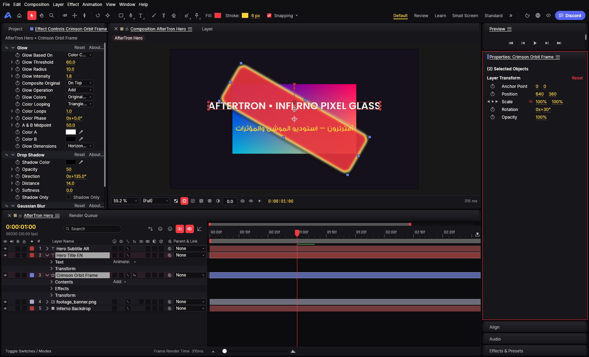
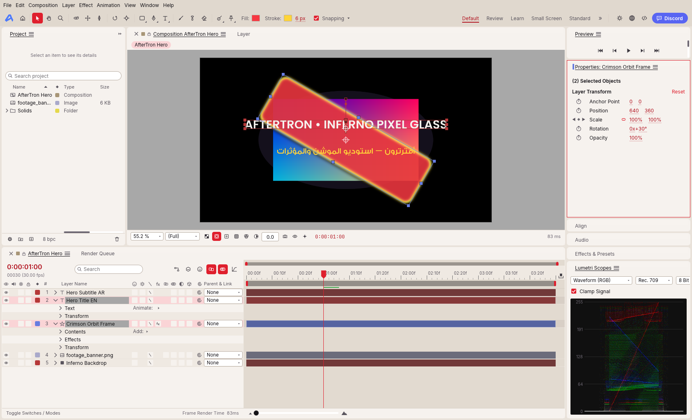
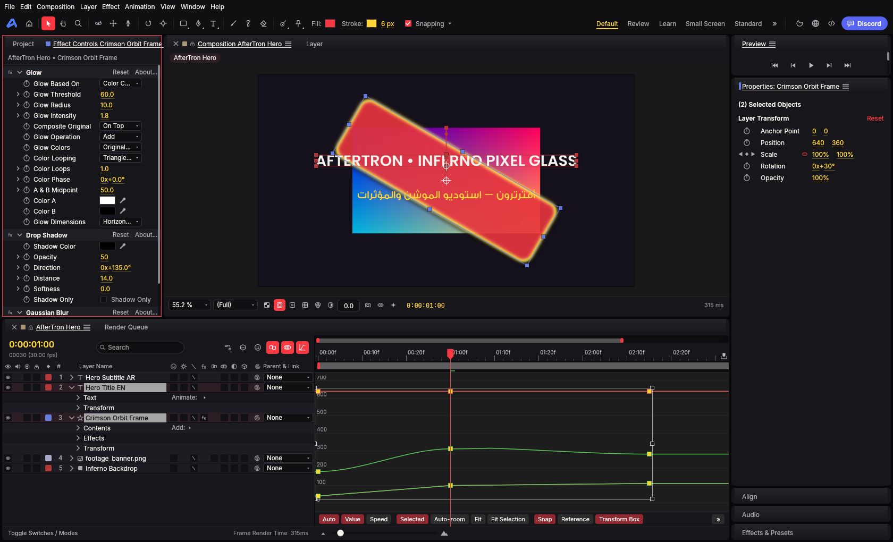
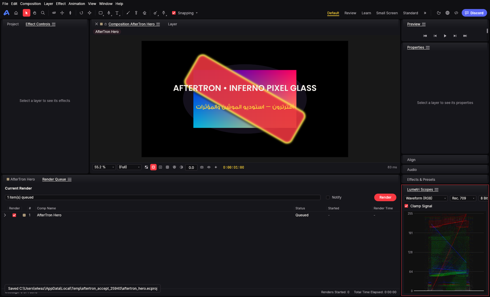

> **2026-10-21 native build, security, UI/UX & acceptance verified:** Upstream `storytold/effectcraft@de3fec28ed7a3d7a700a9d8ea307779dcda99a8e` is merged with full Git ancestry and verified on Windows 11 x64 (`wgpu` DX12 + CPU fallback). Native control authentication (`ControlAuthToken` + RAII `ConnectionSlot`), **Inferno Pixel Glass** Dark & Light themes (`gemi-core.v1.json`), `GemiFontSans` + Arabic RTL shaping, GemiMCP product manifest (`contracts/gemimcp-product-aftertron.v1.json`, 315 tools), OIDC PKCE (`auth.gemitron.net`), and GemiGuard Ed25519 offline lease verification are implemented and verified. See [security audit](docs/implementation/07-NATIVE-CONTROL-AND-MCP-SECURITY-AUDIT.md), [completeness & parity matrix](docs/implementation/08-SOURCE-COMPLETENESS-AND-PARITY-MATRIX.md), [original upstream README](docs/upstream/ORIGINAL-README.md), and [source receipt](docs/upstream/IMPORT-RECORD.txt).

# AfterTron — Independent Native Motion Graphics & VFX Compositor

**Product:** Professional After Effects-class compositor, motion graphics, and visual effects desktop application in pure Rust.  
**Canonical repo:** [`Elwazeery/AfterTron`](https://github.com/Elwazeery/AfterTron)  
**Approved upstream:** [`storytold/effectcraft`](https://github.com/storytold/effectcraft) — preserves full upstream history, MIT OR Apache-2.0 dual licensing, `ATTRIBUTION.md`, and `.attribution` sidecars.  
**Creative product independence:** Independent of GemiMotion, PhotoTron, and FilmTron. No merged editing engines or duplicated cloud MCP server runtimes.  
**Unified Cloud MCP:** [`GemiTron88/GemiMCP`](https://github.com/GemiTron88/GemiMCP) is the sole platform cloud MCP runtime owner (`https://mcp.gemitron.net/products/after/mcp`). AfterTron publishes its versioned capability & tool manifest at [`contracts/gemimcp-product-aftertron.v1.json`](contracts/gemimcp-product-aftertron.v1.json) and bridges commands via `OutboundBridgeAdapter` (`crates/automation/src/gemimcp.rs`).

## Visual Preview — Inferno Pixel Glass UI

| Inferno Pixel Glass Dark (`inferno-dark`) | Inferno Pixel Glass Light (`inferno-light`) |
|---|---|
|  |  |

| Graph Editor & Effect Controls | Render Queue & Lumetri Scopes |
|---|---|
|  |  |

## Verified Architecture & Capabilities

- **Exact Flick Timebase & Compositing (`crates/time`, `crates/render`, `crates/gpu`):** Frame-exact `Tick` ($705{,}600{,}000\text{ ticks/s}$) timing, 8/16/32-bpc compositing, 38 blend modes, Classic 3D & Advanced 3D ray-marched renderer, motion blur, track mattes, and feather/expansion masks with `wgpu` GPU acceleration and automatic CPU fallback (`GpuFailureBridge`).
- **Animation, Expressions & 213 Built-In Effects (`crates/keyframe`, `crates/expr`, `crates/effects`):** Linear, Hold, and Cubic Bezier spatial/temporal interpolation, Easy Ease, Value & Speed Graph Editor, sandboxed JavaScript expressions (`boa_engine`), and 213 effects across 19 categories plus WebAssembly (`wasmi`) plugins.
- **Typography & Arabic RTL (`crates/text`):** Bundled `GemiFontSans` (Light, Medium, Bold), `Inter`, `JetBrains Mono`, and `Noto Serif` with `skrifa` + `harfrust` OpenType shaping, contextual Arabic joining, right-to-left glyph layout, and per-character text animators.
- **Inferno Pixel Glass Theme System (`crates/ui-egui/src/theme.rs`):** Calibrated to `Gemi-Tokens/tokens/gemi-core.v1.json` (`#08080A` obsidian canvas, `#101013` elevated surface, `#F83942` Inferno Crimson accent, `#FFD437` Signal Gold hot-text/timecode) while keeping the composition viewer pasteboard strictly color-neutral (`R == G == B`) for accurate color grading.
- **Authenticated Local Control & GemiMCP Parity (`apps/effectcraft/src/control_server.rs`, `crates/automation`):** Per-launch 256-bit CSPRNG hex token (`ControlAuthToken`), mandatory `auth` handshake within 10s deadline, loopback-only bind enforcement, owner-only token file ACL (`--control-token-out`), RAII `ConnectionSlot`, `AuthorizedWorkspace` path confinement, `expectedRevision` optimistic concurrency, and `idempotencyKey` replay protection.
- **Unified Identity & GemiGuard Offline Entitlements (`crates/automation/src/gemiguard.rs`):** OIDC PKCE (`S256`) authorization request builder for `https://auth.gemitron.net` and pure-Rust RFC 8032 Ed25519 offline lease & revocation list verifier that always preserves local `.ecproj` access (`preserve_user_project_data: true`, `allows_local_project_io: true`).

## Canonical Documentation

- [Product and complete MCP parity implementation charter](docs/01-FORK-PRODUCT-AND-CLOUD-MCP-CHARTER.md)
- [Native control & cloud MCP security audit](docs/implementation/07-NATIVE-CONTROL-AND-MCP-SECURITY-AUDIT.md)
- [Deep source completeness & parity matrix](docs/implementation/08-SOURCE-COMPLETENESS-AND-PARITY-MATRIX.md)
- [Execution task backlog](TODO.md)
- [Asset attribution index](ATTRIBUTION.md)

## 2026-10-21 — TRON optional local creative AI: design intake only

**Scope amendment (owner-approved; implementation NOT STARTED):** [TRON hybrid design](docs/creative-ai/TRON-LOCAL-CREATIVE-INTEGRATION-20261021.md); [TRON Egyptian Gen Z persona/training](https://github.com/GemiTron88/GemiMCP/blob/main/docs/creative-ai/TRON-PERSONA-AND-TRAINING-STRATEGY.v1.md); [shared creative rules](https://github.com/GemiTron88/GemiMCP/blob/main/docs/creative-ai/CREATIVE-KNOWLEDGE-AND-WORKFLOWS.v1.md); [optional ChatGPT->TRON delegation](https://github.com/GemiTron88/GemiMCP/blob/main/contracts/CREATIVE-AI-DELEGATION.v1.md). This specifically amends older no-local-AI statements while retaining ChatGPT-first, independent native editors, ONLY GemiMCP cloud MCP server, Gemi Access/GemiGuard, no paid model API and no mandatory downloads. One shared AI runtime, Qwen3.5-4B quant **candidate for inference** only; no Qwen3.5-4B/6GB-QLoRA feasibility claim. Closing last tab/job lease unloads GPU weights; other app leases must not be interrupted. **No model installed, trained, measured or deployed from this change.**
